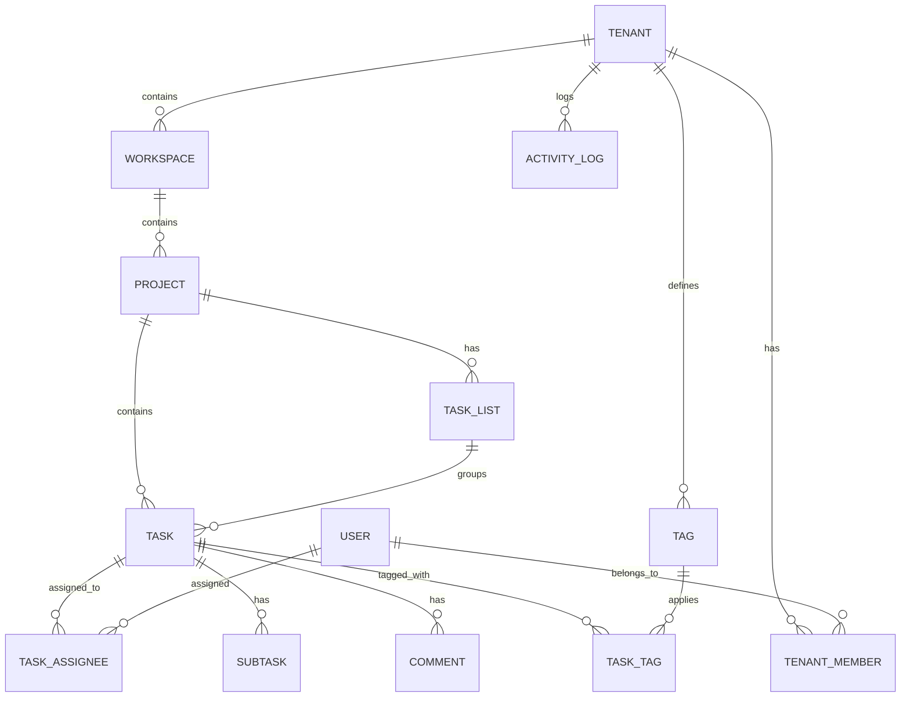

# Ringo Todo

[](LICENSE)
[](https://nextjs.org/)
[](https://react.dev/)
[](https://www.typescriptlang.org/)
[](https://github.com/tursodatabase/libsql-client-ts)
[](https://www.appxiom.com)

**Ringo Todo** is a fast, modern, and open-source project management & multi-tenant productivity platform built with **Next.js 16 (App Router)**, **React 19**, **TypeScript**, and **LibSQL / SQLite**.

Designed for individuals and collaborative teams, Ringo Todo combines flexible task views (Kanban, List, Calendar, Timeline), built-in deep-work Pomodoro timer, comprehensive productivity analytics, multi-tenant workspace isolation, and telemetry goal tracking into a sleek glassmorphic interface.

---

## Table of Contents

- [Features](#features)
- [Architecture & Tech Stack](#architecture--tech-stack)
  - [Project Structure](#architecture--tech-stack)
  - [Technologies](#technologies)
- [Database Schema & Data Model](#database-schema--data-model)
  - [Entity Relationship Diagram](#database-schema--data-model)
  - [Primary Tables](#primary-tables)
- [Getting Started](#getting-started)
  - [Prerequisites](#prerequisites)
  - [Installation & Setup](#installation)
- [Available Scripts](#available-scripts)
- [API Endpoints Reference](#api-endpoints-reference)
- [Design System & Customization](#design-system--customization)
- [Contributing](#contributing)
  - [Coding Guidelines](#coding-guidelines)
- [License](#license)

---

## Features

- **Multi-Tenancy & Workspace Hierarchy**:
  - Full organization-level tenant switching with custom brand colors and logos.
  - Multi-workspace and multi-project segmentation.
  - Role-based membership (`owner`, `admin`, `member`) and team directories.
- **Multi-Dimensional Project Views**:
  - **Kanban Board**: Drag-and-drop swimlanes with custom task lists and statuses.
  - **Interactive List**: High-density task table with sorting, grouping, and batch operations.
  - **Calendar**: Deadlines, scheduled work, and milestones at a glance.
  - **Timeline / Gantt**: Visual schedule planning and dependency monitoring.
- **Deep-Work Focus Mode (Pomodoro)**:
  - Configurable focus & break intervals (25/5 min default).
  - Audio and celebration effects (confetti) on session completion.
  - Direct goal flow telemetry integration for tracking completed sessions.
- **Productivity Analytics Dashboard**:
  - Real-time team velocity, completion ratios, and historical task trends.
  - Member workload distribution and estimated vs. actual hours tracking.
  - Breakdown by priority (`urgent`, `high`, `medium`, `low`) and status.
- **Developer & Power-User Shortcuts**:
  - **Command Palette (`⌘K` / `Ctrl+K`)**: Instant navigation across projects, views, and quick actions.
  - **Quick Add (`C` / Quick Modal)**: Rapid task creation from anywhere.
  - Full keyboard accessibility and dark/light theme switching.
- **Rich Task Management**:
  - Subtask checklists with progress computation.
  - Real-time activity log and threaded comments.
  - Time tracking (estimated vs. actual hours), due dates, assignees, and custom colored tags.
- **Integrated Goal & Telemetry Analytics**:
  - Native integration with `@appxiom/4react` to measure user journeys, feature adoption, and session goals.

---

## Architecture & Tech Stack

```
ringo-todo/
├── src/
│   ├── app/                 # Next.js App Router (Pages, Layouts & API Route Handlers)
│   │   ├── api/             # REST API endpoints (tasks, projects, tenants, analytics, etc.)
│   │   ├── globals.css      # CSS Design System, tokens, glassmorphism utilities & themes
│   │   ├── layout.tsx       # Root layout & context providers
│   │   └── page.tsx         # Main entry point mounting AppShell
│   ├── components/          # Reusable UI component modules
│   │   ├── admin/           # Workspace, tenant, and member management modals
│   │   ├── analytics/       # Analytics charts, metrics, and workload visualizations
│   │   ├── board/           # Kanban column & card components
│   │   ├── calendar/        # Calendar grid and date picker components
│   │   ├── common/          # Command palette, modals, icons, badges
│   │   ├── focus/           # Pomodoro timer and focus mode UI
│   │   ├── layout/          # AppShell, Sidebar, Header, User Menu
│   │   ├── list/            # List view and table rows
│   │   ├── my-tasks/        # User-filtered personalized task view
│   │   ├── task/            # Task detail drawer, creation modal, subtasks, comments
│   │   └── timeline/        # Gantt / timeline scheduling view
│   ├── context/             # AppContext (Global state for tenants, projects, filters)
│   └── lib/                 # Core utilities
│       ├── ax-client.tsx    # Appxiom telemetry client provider
│       └── db/              # LibSQL/SQLite connection, schema migrations, and queries
├── public/                  # Static assets and icons
├── scripts/                 # Build & deployment helper scripts
└── ringo-todo.sqlite        # Embedded SQLite database file
```

### Technologies

| Layer              | Technology                                                                                |
| :----------------- | :---------------------------------------------------------------------------------------- |
| **Framework**      | [Next.js 16 (App Router)](https://nextjs.org/)                                            |
| **UI Library**     | [React 19](https://react.dev/)                                                            |
| **Language**       | [TypeScript 5](https://www.typescriptlang.org/)                                           |
| **Styling**        | Vanilla CSS with Custom Design Tokens & Glassmorphism                                     |
| **Icons**          | [Lucide React](https://lucide.dev/)                                                       |
| **Database**       | [LibSQL / SQLite](https://github.com/tursodatabase/libsql-client-ts) via `@libsql/client` |
| **Telemetry**      | [@appxiom/4react](https://appxiom.com)                                                    |
| **Visual Effects** | [Canvas Confetti](https://www.npmjs.com/package/canvas-confetti)                          |

---

## Database Schema & Data Model

Ringo Todo uses `@libsql/client` to execute SQL queries on an embedded SQLite database (`ringo-todo.sqlite`). The schema initializes automatically on first run and seeds sample demo data for rapid onboarding.



### Primary Tables

- `tenants`: Organizations with branding, custom slug, and subscription tier.
- `users`: User profiles, avatars, and job titles.
- `tenant_members`: Many-to-many relationship linking users to tenants with roles (`owner`, `admin`, `member`).
- `workspaces`: Workspaces under a tenant (e.g., Engineering, Marketing, Design).
- `projects`: Projects within a workspace with default view modes and color palettes.
- `task_lists`: Swimlane columns (e.g., "Backlog", "In Progress", "Review", "Done").
- `tasks`: Core task entities with priority, status, estimates, due date, and completion metadata.
- `subtasks`: Checklists nested under individual tasks.
- `comments`: Discussion threads linked to tasks and users.
- `activity_logs`: Audit trail of actions performed within the tenant.
- `tags` & `task_tags`: Multi-label tagging taxonomy.

---

## Getting Started

### Prerequisites

- **Node.js**: `v18.18.0` or later (Node 20+ recommended)
- **Package Manager**: `npm`, `pnpm`, `yarn`, or `bun`

### Installation

1. **Clone the repository**:

   ```bash
   git clone https://github.com/rp-bg/ringo.git
   cd ringo
   ```

2. **Install dependencies**:

   ```bash
   npm install
   ```

3. **Configure Environment Variables**:
   Create a `.env.local` file in the root directory (or copy from `.env`):

   ```env
   # Appxiom Goal Tracking & Telemetry (Optional for local dev)
   NEXT_PUBLIC_APPXIOM_APP_KEY=your_appxiom_app_key
   NEXT_PUBLIC_APPXIOM_PLATFORM_KEY=your_appxiom_platform_key
   ```

4. **Run the development server**:

   ```bash
   npm run dev
   ```

5. **Open your browser**:
   Navigate to [http://localhost:3000](http://localhost:3000). The database will automatically initialize and populate with demo data.

---

## Available Scripts

| Command         | Description                                                                                      |
| :-------------- | :----------------------------------------------------------------------------------------------- |
| `npm run dev`   | Starts the Next.js development server on port 3000                                               |
| `npm run build` | Increments build number via `scripts/update-build.mjs` and creates an optimized production bundle |
| `npm run start` | Runs the compiled Next.js production server                                                      |
| `npm run lint`  | Runs ESLint to check for code style, type errors, and Next.js compiler rules                     |

---

## API Endpoints Reference

The Next.js App Router exposes typed REST API handlers under `/api/*`:

| Endpoint          | Methods                          | Description                                                                    |
| :---------------- | :------------------------------- | :----------------------------------------------------------------------------- |
| `/api/tasks`      | `GET`, `POST`                    | Query tasks (filter by tenant, project, assignee, status) or create a new task |
| `/api/tasks/[id]` | `GET`, `PATCH`, `DELETE`         | Retrieve, update task fields/status, or delete a task                          |
| `/api/projects`   | `GET`, `POST`, `PATCH`, `DELETE` | Manage projects, list orders, and view configurations                          |
| `/api/workspaces` | `GET`, `POST`, `PATCH`, `DELETE` | Workspace CRUD operations                                                      |
| `/api/tenants`    | `GET`, `POST`, `PATCH`           | Tenant settings, custom themes, and organization profile                       |
| `/api/members`    | `GET`, `POST`, `DELETE`          | Manage team members and permission roles                                       |
| `/api/analytics`  | `GET`                            | Calculate productivity metrics, velocity, and workload distribution            |
| `/api/activity`   | `GET`, `POST`                    | Audit logging and activity stream                                              |

---

## Design System & Customization

The interface relies on clean, modern CSS custom properties (`var(--...)`) defined in [src/app/globals.css](file:///Users/robinpanicker/dev/web/ringo-todo/src/app/globals.css):

- **Dynamic Theming**: Easily switch between Dark Mode and Light Mode with zero CSS-in-JS overhead.
- **Glassmorphism**: Backdrop blurs (`backdrop-filter: blur(12px)`), translucent card layers, and subtle borders.
- **Typography & Motion**: Curated font stack with smooth transition physics and micro-interactions.

---

## Contributing

Contributions from the open-source community are warmly welcomed!

1. **Fork the repository** on GitHub.
2. **Create a feature branch**:
   ```bash
   git checkout -b feature/amazing-feature
   ```
3. **Commit your changes**:
   ```bash
   git commit -m "feat: add amazing feature"
   ```
4. **Push to the branch**:
   ```bash
   git push origin feature/amazing-feature
   ```
5. **Open a Pull Request** describing your changes.

### Coding Guidelines

- Maintain TypeScript strictness and ensure `npm run lint` passes without errors.
- Preserve existing comments and docstrings.
- Avoid unnecessary external dependencies when vanilla CSS or standard Web APIs suffice.

---

## License

Distributed under the **MIT License**. See [LICENSE](LICENSE) for more information.
